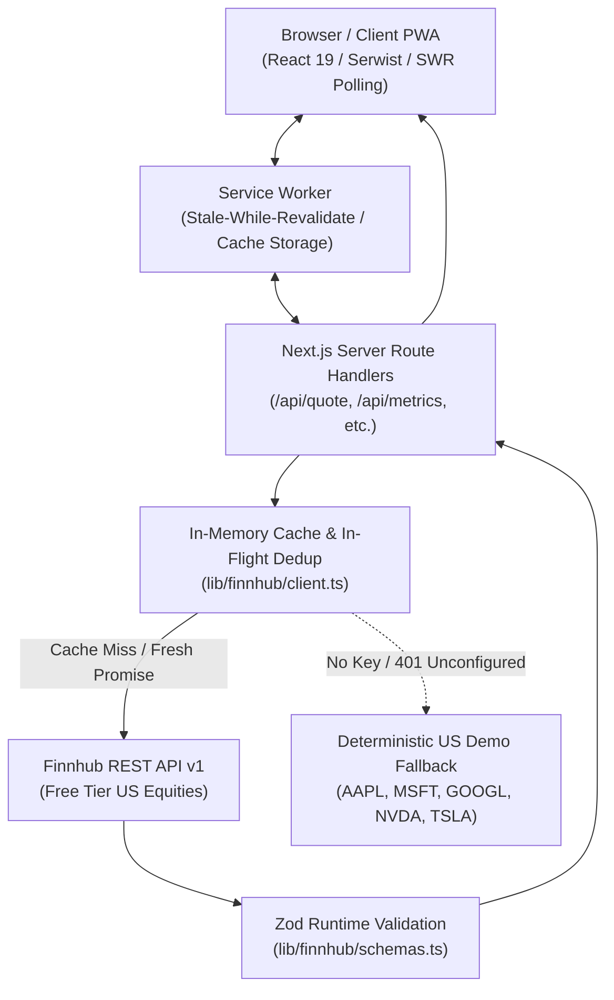

# MarketDash — Finnhub US Financial Market Dashboard

[](https://github.com/omojola/financial-market-dashboard/actions/workflows/ci.yml)
[](https://nextjs.org/)
[](https://react.dev/)
[](https://www.typescriptlang.org/)
[](https://tailwindcss.com/)
[](https://jestjs.io/)
[](https://serwist.pages.dev/)
[](LICENSE)

An enterprise-ready, offline-first Progressive Web App (PWA) for real-time tracking, charting, and fundamental analysis of US equity markets. Built with **Next.js 16 (App Router)**, **React 19**, **Tailwind CSS v4**, and **Serwist**, strictly leveraging the **Finnhub Free REST API** with robust rate-limiting, server-side credential isolation, and automated fallback capabilities.

---

## Table of Contents

- [Overview & Key Features](#overview--key-features)
- [Architecture & Design Decisions](#architecture--design-decisions)
  - [System Flow & Proxy Design](#system-flow--proxy-design)
  - [Rate Limiting, In-Flight Deduplication & Caching](#rate-limiting-in-flight-deduplication--caching)
  - [Resilient Offline & PWA Strategy](#resilient-offline--pwa-strategy)
- [Finnhub Free Tier Compliance & Endpoints](#finnhub-free-tier-compliance--endpoints)
  - [Active Endpoints & Cache TTLs](#active-endpoints--cache-ttls)
  - [Explicitly Excluded Premium Features](#explicitly-excluded-premium-features)
- [Tech Stack](#tech-stack)
- [Directory Structure](#directory-structure)
- [Getting Started](#getting-started)
  - [Prerequisites](#prerequisites)
  - [Installation & Local Setup](#installation--local-setup)
  - [Environment Variables](#environment-variables)
- [Docker & Containerization](#docker--containerization)
  - [Docker Compose (Local Development)](#docker-compose-local-development)
  - [Standalone Multi-Stage Dockerfile](#standalone-multi-stage-dockerfile)
- [Testing & Code Quality](#testing--code-quality)
- [Health Checks & Observability](#health-checks--observability)
- [Troubleshooting & FAQ](#troubleshooting--faq)
- [Deployment](#deployment)
- [License](#license)

---

## Overview & Key Features

MarketDash delivers real-time stock inspection and equity analytics without requiring user registration, authentication servers, or client-side secret tokens.

- **Zero Client Secret Exposure:** Every Finnhub API request is proxied through server-side Next.js route handlers (`/api/*`). The API token never enters client bundles or network requests.
- **Strict Free-Tier Rate Management:** Hardened against Finnhub's free limits (30 calls/second, 60 calls/minute) via in-memory deduplication, per-endpoint TTL caching, jittered exponential backoff, and visibility-aware client polling (30s).
- **Runtime Schema Validation:** All incoming and outgoing data payloads are parsed at runtime using **Zod** (`lib/finnhub/schemas.ts`), guarding against upstream schema mutations or `null` attributes.
- **Offline-First PWA (Powered by Serwist):** Precached application shell, Web App Manifest, dynamic offline quote persistence (`localStorage`), custom icons (maskable, any, apple-touch-icon), in-app installation prompt, and an active `/~offline` recovery view.
- **Deep Fundamental & Alternative Datasets:** Includes SEC filings, quarterly EPS surprises, analyst recommendation consensus, company financials, executive insider transactions, insider sentiment, peer comparisons, government patent grants, visa filings, and lobbying disclosures.
- **High-Performance Lightweight Visualizations:** Zero-dependency custom SVG candlestick and area charts with crosshairs, metrics tooltips, dynamic intervals (1D, 1W, 1M, 1Y, ALL), and automated candle synthesis fallback when candles encounter upstream `403` free-tier restrictions.
- **Accessibility & UX Polishing:** Keyboard navigation (`⌘K` / `Ctrl+K` symbol search dialog), zero-flash persisted dark/light theme toggle, mobile bottom navigation, responsive sidebar, and full `prefers-reduced-motion` compliance.

---

## Architecture & Design Decisions

### System Flow & Proxy Design



### Rate Limiting, In-Flight Deduplication & Caching

1. **In-Flight Request Deduplication:** If multiple client components mount concurrently and request identical data (e.g. quote for `AAPL`), only a single outbound fetch is dispatched to Finnhub. All subsequent callers share the in-flight Promise.
2. **Per-Endpoint TTL Cache:** Once resolved, payloads are cached in server memory using granular TTL durations aligned with financial volatility and Finnhub update cycles.
3. **HTTP 429 Jittered Exponential Backoff:** On upstream `429` (Too Many Requests), the client automatically pauses with randomized jitter (`baseWait * 2^(attempt - 1) + jitter`), retrying up to 3 times before returning a structured, user-friendly error.
4. **Visibility-Aware Polling:** Client hooks stop polling while the browser tab is hidden or backgrounded via `document.visibilityState`, preserving quota.

### Resilient Offline & PWA Strategy

- **Serwist Worker:** Pre-caches static assets, scripts, and navigation routes.
- **Local Quote Snapshots:** Every received quote updates `localStorage` (`lib/quote-storage.ts`). If network connectivity drops or the user navigates while offline, MarketDash renders the cached snapshot annotated with an offline badge.
- **Graceful Fallback (`/~offline`):** Serves an isolated, fully functional offline screen when accessing unreachable routes.

---

## Finnhub Free Tier Compliance & Endpoints

MarketDash strictly uses the free tier of the Finnhub REST API, enforcing standard US ticker formatting (`/^[A-Z]{1,5}(\.[ABC])?$/`).

### Active Endpoints & Cache TTLs

| Endpoint Route              | Finnhub Resource               | Cache TTL  | Purpose                                                      |
| :-------------------------- | :----------------------------- | :--------- | :----------------------------------------------------------- |
| `/api/quote`                | `/quote`                       | 30 seconds | Real-time price, change, high, low, open, previous close     |
| `/api/candle`               | `/stock/candle` (or synthetic) | 5 minutes  | Historical OHLCV candlestick & area chart data               |
| `/api/profile`              | `/stock/profile2`              | 24 hours   | Company overview, industry, market cap, shares outstanding   |
| `/api/metrics`              | `/stock/metric?metric=all`     | 6 hours    | 52-week high/low, P/E, P/B, ROE, margins, beta               |
| `/api/news`                 | `/company-news` & `/news`      | 10 minutes | Ticker-specific and market-wide financial headlines          |
| `/api/search`               | `/search` & `/stock/symbol`    | 1 hour     | US symbol lookup and real-time autocomplete                  |
| `/api/peers`                | `/stock/peers`                 | 24 hours   | Industry competitor and peer tickers                         |
| `/api/earnings`             | `/stock/earnings`              | 6 hours    | Historical quarterly EPS estimates vs. actuals               |
| `/api/recommendation`       | `/stock/recommendation`        | 6 hours    | Analyst consensus (Strong Buy, Buy, Hold, Sell, Strong Sell) |
| `/api/market-status`        | `/stock/market-status`         | 1 minute   | US equity exchange operational status (open/closed)          |
| `/api/market-holiday`       | `/stock/market-holiday`        | 24 hours   | Official trading holiday schedule                            |
| `/api/sec-filings`          | `/stock/filings`               | 2 hours    | Recent SEC 10-K, 10-Q, 8-K filings with direct links         |
| `/api/financials-reported`  | `/stock/financials-reported`   | 12 hours   | Raw reported balance sheet and income statement items        |
| `/api/insider-transactions` | `/stock/insider-transactions`  | 6 hours    | Executive/director open-market transactions                  |
| `/api/insider-sentiment`    | `/stock/insider-sentiment`     | 6 hours    | Monthly Share Purchase Ratio (MSPR) insider sentiment        |
| `/api/earnings-calendar`    | `/calendar/earnings`           | 6 hours    | Upcoming corporate earnings releases                         |
| `/api/ipo-calendar`         | `/calendar/ipo`                | 6 hours    | Upcoming and recent public offerings                         |
| `/api/patents`              | `/stock/uspto-patent`          | 12 hours   | USPTO patent grants and innovation tracking                  |
| `/api/visas`                | `/stock/visa-application`      | 12 hours   | H-1B visa applications and talent acquisition                |
| `/api/lobbying`             | `/stock/lobbying`              | 12 hours   | Senate/House government lobbying expenditures                |
| `/api/usa-spending`         | `/stock/usa-spending`          | 12 hours   | US federal procurement awards and government contracts       |
| `/api/health`               | _Internal_                     | Real-time  | Diagnostic endpoint detailing API key status & limits        |

### Explicitly Excluded Premium Features

To guarantee zero surprise billing and avoid `403 Forbidden` failures, paid-only Finnhub endpoints are omitted:

- Full Company Profile (`/stock/profile`) — substituted with free `/stock/profile2`
- Institutional Ownership & 13-F Portfolios (`/stock/ownership`, `/institutional/*`)
- Paid Analyst Price Targets & Revisions (`/stock/price-target`, `/stock/upgrade-downgrade`)
- Forward EPS / Revenue Consensus Forecasts (`/stock/eps-estimate`, `/stock/revenue-estimate`)
- News & Social Sentiment Analytics (`/news-sentiment`, `/stock/social-sentiment`)
- Earnings Call Transcripts & Press Releases (`/press-releases`, `/stock/transcripts`)
- Non-US Exchange Tickers & Real-Time WebSocket relays (which leak API keys in URL parameters)

---

## Tech Stack

- **Framework:** [Next.js 16](https://nextjs.org/) (App Router, React Server Components, Route Handlers)
- **Library:** [React 19](https://react.dev/)
- **Language:** [TypeScript 5](https://www.typescriptlang.org/) (Strict mode enabled)
- **Styling:** [Tailwind CSS v4](https://tailwindcss.com/) with `@tailwindcss/postcss` & typography
- **Animations:** [Motion](https://motion.dev/) (respects system `prefers-reduced-motion`)
- **Icons & Feedback:** [Lucide React](https://lucide.dev/), [Sonner](https://sonner.emilkowal.ski/)
- **Validation:** [Zod v4](https://zod.dev/)
- **PWA & Offline:** [Serwist](https://serwist.pages.dev/) (`@serwist/next`)
- **Testing:** [Jest](https://jestjs.io/), [React Testing Library](https://testing-library.com/), [MSW (Mock Service Worker)](https://mswjs.io/)
- **Package Manager:** [pnpm](https://pnpm.io/) (v12.15.0 via Corepack)
- **Containerization:** Docker & Docker Compose (Multi-stage Node 20 Alpine)

---

## Directory Structure

```text
financial-market-dashboard/
├── .github/
│   └── workflows/
│       └── ci.yml                # GitHub Actions: Typecheck, Lint, Test & Build
├── app/
│   ├── api/                      # 21 Server-only proxy route handlers
│   │   ├── candle/               # OHLCV candles with synthetic fallback
│   │   ├── quote/                # Real-time equity quote
│   │   ├── search/               # Symbol search & autocomplete
│   │   ├── health/               # Diagnostic health check
│   │   └── ...                   # Metrics, filings, insider, news, etc.
│   ├── dashboard/                # Main dashboard view with loading & error boundaries
│   ├── ~offline/                 # Dedicated offline fallback page
│   ├── globals.css               # Tailwind CSS v4 directives & theme variables
│   ├── layout.tsx                # Root layout, zero-flash theme script & fonts
│   ├── manifest.ts               # Web App Manifest generator
│   ├── page.tsx                  # Landing hero page
│   └── sw.ts                     # Serwist service worker source
├── components/                   # Modular typed React UI components
│   ├── analyst-recommendations-card.tsx
│   ├── company-profile-card.tsx
│   ├── dashboard-shell.tsx
│   ├── earnings-surprises-card.tsx
│   ├── market-news-feed.tsx
│   ├── market-status-pill.tsx
│   ├── navbar.tsx
│   ├── offline-indicator.tsx
│   ├── price-chart.tsx           # Custom zero-dependency SVG candlestick/area chart
│   ├── quote-card.tsx
│   ├── sec-filings-card.tsx
│   ├── sidebar.tsx
│   └── symbol-search-dialog.tsx  # ⌘K / Ctrl+K search dialog
├── hooks/                        # Custom client hooks
│   ├── use-online-status.ts      # Browser online/offline state
│   ├── use-pwa-install.ts        # PWA prompt & installation listener
│   └── use-watchlist.ts          # localStorage multi-tab synchronized watchlist
├── lib/
│   ├── api-response.ts           # Standardized Cache-Control & error responder
│   ├── config.ts                 # Rate limits, TTLs, US symbol regex, error messages
│   ├── env.ts                    # Startup environment validator
│   ├── quote-storage.ts          # LocalStorage offline quote snapshots
│   ├── utils.ts                  # Classname merging & formatters
│   └── finnhub/
│       ├── client.ts             # Deduplicated, cached, retry-enabled server client
│       └── schemas.ts            # Zod runtime verification schemas
├── public/                       # PWA icons (192, 512, maskable, apple) & static assets
├── tests/                        # Comprehensive Jest + RTL + MSW test suites
│   ├── mocks/server.ts           # MSW mock server for upstream Finnhub tests
│   ├── client.test.ts            # Unit tests for caching, dedup, and retries
│   ├── components.test.tsx       # Component interaction & rendering tests
│   ├── hooks-and-theme.test.tsx  # Watchlist, online status, and theme tests
│   └── routes.test.ts            # API route handler integration tests
├── .env.example                  # Environment template
├── docker-compose.yml            # Docker development configuration
├── Dockerfile                    # Production multi-stage container
├── jest.config.ts                # Jest configuration with fixed JSDOM & paths
├── next.config.ts                # Next.js config with Serwist & Bundle Analyzer
├── package.json
└── tsconfig.json
```

---

## Getting Started

### Prerequisites

- **Node.js:** `^20.x` or `^22.x` (CI runs on `24.21.0`)
- **pnpm:** `12.15.0` (Recommended; managed automatically via `corepack enable`)
- **Finnhub API Key:** Obtain a free API key at [finnhub.io](https://finnhub.io) _(optional for development; demo data is served when omitted)_.

### Installation & Local Setup

1. **Clone the repository:**

   ```bash
   git clone https://github.com/omojola/financial-market-dashboard.git
   cd financial-market-dashboard
   ```

2. **Enable Corepack and install dependencies:**

   ```bash
   corepack enable
   pnpm install
   ```

3. **Configure environment variables:**

   ```bash
   cp .env.example .env.local
   ```

   Open `.env.local` and configure your settings:

   ```env
   FINNHUB_API_KEY="your_api_key_here"
   STRICT_FINNHUB_KEY="false"
   ```

4. **Start the development server:**
   ```bash
   pnpm run dev
   ```
   Open [http://localhost:3000](http://localhost:3000) in your browser.

---

## Environment Variables

| Variable             |    Required     |         Default         | Description                                                                                                  |
| :------------------- | :-------------: | :---------------------: | :----------------------------------------------------------------------------------------------------------- |
| `FINNHUB_API_KEY`    | **Recommended** |          `""`           | Free-tier Finnhub REST API token. Kept exclusively server-side. If unset, deterministic demo data is served. |
| `STRICT_FINNHUB_KEY` |    Optional     |        `"false"`        | When set to `"true"`, the server throws an error during startup if `FINNHUB_API_KEY` is not defined.         |
| `APP_URL`            |    Optional     | `http://localhost:3000` | Canonical host URL used for self-referential links and metadata.                                             |
| `ANALYZE`            |    Optional     |        `"false"`        | When set to `"true"` during `pnpm run build`, launches `@next/bundle-analyzer`.                              |

---

## Docker & Containerization

### Docker Compose (Local Development)

Run a containerized development environment with hot-reloading:

```bash
# Ensure .env.local exists
cp .env.example .env.local

# Launch the development container
docker compose up
```

Access the application at [http://localhost:3000](http://localhost:3000).

### Standalone Multi-Stage Dockerfile

MarketDash includes an optimized 3-stage `Dockerfile` (`deps` &rarr; `builder` &rarr; `runner`) taking advantage of Next.js standalone output to produce lightweight, secure, non-root containers.

```bash
# Build the production container image
docker build -t marketdash:latest .

# Run the containerized production server
docker run --rm -p 3000:3000 \
  -e FINNHUB_API_KEY="your_api_key_here" \
  -e STRICT_FINNHUB_KEY="true" \
  marketdash:latest
```

---

## Testing & Code Quality

MarketDash maintains a strict quality bar verified by automated GitHub Actions CI.

```bash
# Execute Jest test suite (unit & integration)
pnpm run test

# Run tests with code coverage report (lcov, text)
pnpm run test:coverage

# Run tests in interactive watch mode
pnpm run test:watch

# Strict TypeScript typechecking (noEmit)
pnpm run typecheck

# ESLint inspection
pnpm run lint

# Code formatting with Prettier
pnpm run format

# Inspect client/server bundle sizes
pnpm run analyze
```

---

## Health Checks & Observability

MarketDash provides a dedicated diagnostic endpoint at `/api/health`.

### Sample Health Check Response:

```json
{
  "status": "ok",
  "timestamp": "2026-11-11T00:24:27.000Z",
  "service": "Finnhub Market Dashboard API Proxy",
  "freeTierOnly": true,
  "supportedMarket": "US Stocks",
  "hasApiKey": true,
  "mode": "live",
  "rateLimits": {
    "maxCallsPerSecond": 30,
    "maxCallsPerMinute": 60,
    "backoffBaseMs": 1000,
    "backoffMaxMs": 16000,
    "maxRetries": 3
  }
}
```

Use `/api/health` in Docker health checks, Kubernetes liveness probes, or uptime monitors.

---

## Troubleshooting & FAQ

### 1. "Market data is temporarily unavailable" (HTTP 401 / 403)

- **Cause:** Upstream Finnhub rejected the API key or the request exceeded permissions.
- **Resolution:**
  - Verify `FINNHUB_API_KEY` in `.env.local` contains no trailing whitespace or quotation artifacts.
  - Visit `/api/health` to confirm `"hasApiKey": true`.
  - Check server terminal logs for `[Finnhub Client] Upstream auth error`.

### 2. "We're fetching data too quickly. Retrying shortly." (HTTP 429)

- **Cause:** Free tier limit of 60 calls/minute or burst cap of 30 calls/second was reached.
- **Resolution:**
  - MarketDash automatically executes jittered exponential backoff for up to 3 attempts.
  - Ensure other applications are not sharing the same free API token concurrently.
  - Inspect response headers for `Retry-After`.

### 3. "We couldn't find that symbol. Free data covers US stocks only."

- **Cause:** Finnhub's free tier only covers US-listed equities. Tickers with foreign exchange suffixes (e.g., `SHOP.TO`, `BP.L`, `SAP.DE`) or invalid characters are filtered out.
- **Resolution:** Search for the US-listed ADR or ticker equivalent (e.g., `BTI`, `TSM`, `BABA`).

### 4. How do I test the PWA and Offline Mode?

- Build and run the production server: `pnpm run build && pnpm run start`.
- Open Chrome DevTools &rarr; **Application** &rarr; **Service Workers** to confirm `sw.js` is registered and active.
- Navigate to the **Network** tab, select **Offline**, and refresh the page to observe offline cached quote snapshots and the `/~offline` recovery view.

---

## Deployment

### Deploying to Vercel

1. Push your repository to GitHub.
2. Import the project in the [Vercel Dashboard](https://vercel.com/new).
3. Vercel automatically detects Next.js. In **Project Settings** &rarr; **Environment Variables**, configure:
   - `FINNHUB_API_KEY`: Your Finnhub API Key.
   - `STRICT_FINNHUB_KEY`: `"true"` (recommended for production).
4. Deploy! Production builds will automatically compile standalone output and register the Serwist service worker.

---

## License

This project is built by me.
